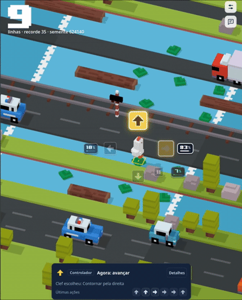
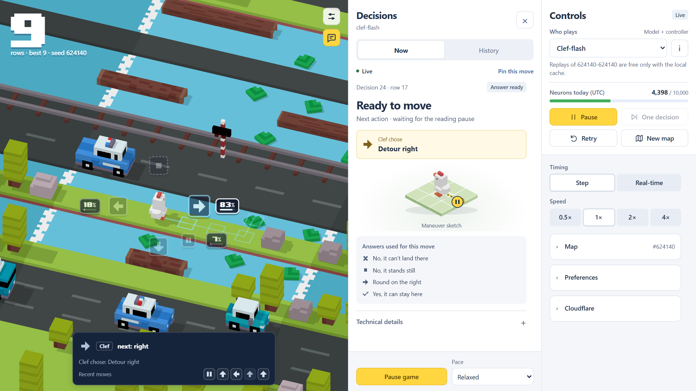

<div align="center">


# Clef Crossy Road

**Can a decision model play Crossy Road?**<br>
Cloudflare's Clef-flash makes the calls in a deterministic Crossy Road clone, and every move says who made it.

[](https://github.com/ramon-victor/clef-crossy-road/actions/workflows/ci.yml)
[](LICENSE)
[](#quick-start)
[](#project-layout)
[](https://v2.tauri.app/)
[](https://developers.cloudflare.com/workers-ai/)

[Quick start](#quick-start) · [How Clef plays](#how-clef-plays) · [Results](#results) · [Benchmark](#benchmark)



<sub>Clef-flash playing seed 624140 in the desktop app (UI in Portuguese).</sub>

</div>

## About

Clef Crossy Road measures how far Cloudflare's **Clef-flash** decision model ([Workers AI](https://developers.cloudflare.com/workers-ai/models/clef-flash/))
gets in Crossy Road when all it gets is the scene in words and a few one-word questions. The game is a deterministic, headless
TypeScript port of the rules of [Evan Bacon's Expo-Crossy-Road](https://github.com/EvanBacon/Expo-Crossy-Road), drawn with
Three.js in a Tauri desktop app or the browser. A benchmark CLI plays every player on the same seeds.

> [!NOTE]
> **Research prototype.** Asked plainly, Clef-flash plays no better than "always forward" (about 3.7 rows). With the scene in
> words and one-word lookups it gets much further, but the 100-seed evaluation is still pending.

- **Words, not pixels.** Code names what is in each cell the chicken could reach. No numbers, no "safe" labels, no list of valid moves.
- **Clef times every hop.** A cell Clef calls standable is hopped on at once. Nothing checks or rescues a wrong answer.
- **Every move says who made it.** The app labels each move *Clef* or *Controller*, and <kbd>I</kbd> shows the exact request and answer.
- **Deterministic.** Seeded randomness and fixed 60 Hz ticks: the same seed and the same moves give the same game.
- **Benchmark CLI.** Many seeds × many players, resumable runs and paired 95% confidence intervals.
- **Free-tier guard.** Every uncached call checks a 10,000-neuron daily ceiling first, and cached answers are free. The UI speaks 7 languages.

## Quick start

You need [Node.js](https://nodejs.org) 24+ and [Git](https://git-scm.com). The init script takes care of pnpm 12.14.0.

```bash
# macOS / Linux
git clone https://github.com/ramon-victor/clef-crossy-road.git
cd clef-crossy-road
./init.sh
```

```powershell
# Windows (PowerShell or cmd)
git clone https://github.com/ramon-victor/clef-crossy-road.git
cd clef-crossy-road
.\init.cmd
```

Init checks Node and Git, makes sure the pinned pnpm runs (it offers the official installer if not), installs the dependencies and
downloads Evan Bacon's models, audio and font. Add `--desktop` to also check Rust. It never reads credentials or calls Cloudflare.

```bash
pnpm run dev            # browser app at http://localhost:5173
pnpm run dev:desktop    # desktop app: needs Rust and the Tauri prerequisites; stop `pnpm run dev` first (same port)
```

The app opens on the free **look-ahead** player, so no token is needed. Pick **You** under **Who plays** to play with the arrow keys or WASD.

<details>
<summary>Manual setup and release build</summary>

```bash
pnpm install --frozen-lockfile
node scripts/fetch-assets.mjs     # Evan Bacon's assets, downloaded locally and gitignored
pnpm run dev
```

- If an older global pnpm cannot run the pinned version, install it with `npx --yes get-pnpm@0.0.5 12.14.0` and open a new terminal.
- Desktop prerequisites: [Rust](https://rustup.rs) and the [Tauri prerequisites](https://v2.tauri.app/start/prerequisites/)
  (MSVC build tools and WebView2 on Windows).
- Release build: `pnpm --filter @ccr/desktop build`, then `pnpm tauri build --no-bundle` inside `apps/desktop`. On Windows,
  `play.cmd` opens it and prints what the model is sent.

The desktop app is verified on Windows. CI checks the TypeScript code and the web build on Windows, Linux and macOS.
</details>

## How Clef plays

<p align="center">
  <picture>
    <source media="(prefers-color-scheme: dark)" srcset="docs/images/clef-flow-dark.svg">
    <source media="(prefers-color-scheme: light)" srcset="docs/images/clef-flow-light.svg">
    
  </picture>
</p>

At every step, code turns the screen into words and sends Clef-flash **one request with four one-word questions** (five on a log).
The answers set the move straight away: *stand* hops now, *moving* waits a step and asks again, and otherwise Clef picks a side
to go round. Code only walks the path of a detour, a step off, or the way off a log. In the default *Step* timing the world waits
for each answer, as in a turn-based game.

<details>
<summary>What Clef read at decision 24 (the step in the screenshot below)</summary>

The state, exactly as sent. Each question tells Clef which one field to read, with solved examples:

```json
{
  "cross_ahead": {"lands_on":"water","things_move":"still"},
  "detour_left": {"opening_ahead":"none","own_row_that_way":"free_for_two_or_more","recently_failed":"no"},
  "detour_right": {"opening_ahead":"three_or_more","own_row_that_way":"free_for_two_or_more","recently_failed":"no"},
  "wait_here": {"stands_on":"empty"},
  "chicken": {"place_in_world":"middle","carried_towards":"no","behind_frontier":"no"},
  "memory": {"last_moves":["hop_forward: moved","hop_left: moved","hop_forward: moved","hop_forward: moved"],"blocked_last_two":false,"no_new_row_for_a_while":false,"last_maneuver":"cross_ahead: hopped"}
}
```

| Question | Clef's answer |
|---|---|
| Can the chicken stand where a hop ahead lands? | `no_stand` 57% (`stand` 43%) |
| Do the things in that row move? | `still` 95% |
| Which way round? | `detour_right` 83% |
| Can it stay where it is? | `remain` 97% |

Water ahead with nothing moving on it closes the way, so the side Clef picked decides: the controller walks the detour to the right. Press
<kbd>I</kbd> in the app to see this for any decision, or run `pnpm bench show-input --seed 4 --actions hop_forward` (nothing is sent).
</details>



<sub>Game, Decisions and Controls in the browser. Decision 24 of a cached Clef-flash replay; it made no API call.</sub>

## Using a model

1. Create a Cloudflare API token with **only** the *Workers AI* permission and an expiry date.
2. In the app, open **Controls → Cloudflare → Configure**, enter your **Account ID** and **API token**, and save. They go to the
   local `.env` (gitignored), and saving never calls the API. You can also copy `.env.example` to `.env` and fill it in.
3. Choose **Clef-flash** or **Clef (27B)** under **Who plays**.

**Mind the budget.** The project stays inside the free tier: 10,000 neurons per UTC day per account, checked before every uncached
call, in Node and again in the Rust process. A request reads about 2,300 tokens (about 8 neurons). A long game makes 150 to 200 of
them, around 1,100 to 1,500 neurons, so about four long games fit in a free day. The 27B model costs about 6.3 times more. Answers
are cached in `runs/` (gitignored), so on a fresh clone the first Clef game on any map spends.

## Results

| Player | Games | Rows crossed (mean) |
|---|---:|---|
| `random` | 100 | 1.84 |
| `always-forward` | 100 | 3.78 |
| Clef-flash, plain prompts (JSON, ASCII grid, the player's view) | 100 | 3.67 – 3.73 |
| Clef-flash, words + lookups, the controller times the hops (earlier revision) | 7 | 22.4 [10.9, 35.7] |
| Clef-flash, words + lookups, **Clef times the hops** (current default) | 1 | 37 (drowned) |
| `lookahead`: reads the simulator, no model | 100 | 44.75 |
| Scripted chooser with the default's controller, **no model** (`exec-route-live`) | 100 | 68.14 [60.9, 75.2] |

The controller is our code, so compare a model row with the scripted row that uses the same controller, not with `always-forward`.
The model rows are small samples from different controller revisions, and the 100-seed evaluation is pending. Full tables and
method: [docs/results.md](docs/results.md).

## Benchmark

```bash
pnpm bench plan   --policies clef --seeds 1..10                                # estimate neurons, split over days
pnpm bench run    --run my-run --policies always-forward,random,lookahead --seeds 1..100
pnpm bench report --run my-run                                                # means, paired deltas, 95% CIs
pnpm bench show-input --seed 4 --actions hop_forward                          # the exact request, nothing sent
```

Model players are named `clef:<model>:<encoder>:<strategy>[:<manual>]`. The default is `clef:clef-flash:scene:route-live:lookup`,
also spelled `clef`. Run `bench plan` before anything that calls a model. Spending commands stop at the daily ceiling, and
`--daily-neurons` can only lower it.

## Project layout

| Path | What it is |
|---|---|
| `packages/core` | Deterministic game simulation, zero dependencies |
| `packages/clef` | Workers AI client: schema, retry, cache, spend budget |
| `packages/agent` | Players, scene words, prompts, route controller, episode runner |
| `packages/render` | Three.js scene built from a read-only snapshot |
| `apps/bench` | Benchmark CLI (no window, no GPU) |
| `apps/desktop` | Tauri v2 app: Preact UI, plus the Rust side that holds the credentials |

## Development

```bash
pnpm check                                       # typecheck, lint and tests; no network, no credentials
cd apps/desktop/src-tauri && cargo test --lib    # Rust
```

Read [CONTRIBUTING.md](CONTRIBUTING.md) before opening a pull request. AI coding agents follow [AGENTS.md](AGENTS.md). Security
notes: [SECURITY.md](SECURITY.md). Design notes and decision records: [docs/](docs/README.md).

## Acknowledgements

- **[Evan Bacon's Expo-Crossy-Road](https://github.com/EvanBacon/Expo-Crossy-Road)** is the base of this game. Its rules,
  constants and row generation are ported to `packages/core`, and its 3D models, audio and font are downloaded from it at setup.
  Thank you, Evan, for open-sourcing it under MIT.
- [Cloudflare Workers AI](https://developers.cloudflare.com/workers-ai/models/clef-flash/) for Clef and its free tier.
- Decision-model game projects whose ideas shaped this one: [mario-jev](https://github.com/shantanugoel/mario-jev),
  [typesafe-mario](https://github.com/fhshaik/typesafe-mario), [jev-drone](https://github.com/RomanSlack/jev-drone) and
  [embodied-jev](https://github.com/FBddcz/embodied-jev).

## License

Code and documentation are [MIT](LICENSE). The ported rules keep Expo-Crossy-Road's MIT notice in [NOTICE](NOTICE). The game
assets replicate the original Crossy Road and are **not in this repository**: setup downloads them locally. Release builds embed
them, so do not distribute binaries without replacing the assets and the name. This project is not affiliated with or endorsed
by Hipster Whale (makers of Crossy Road), Evan Bacon or Cloudflare.
