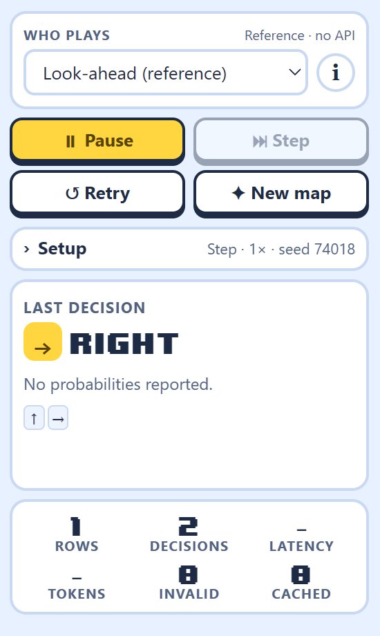
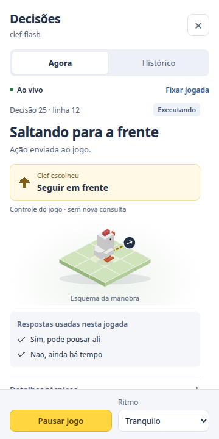
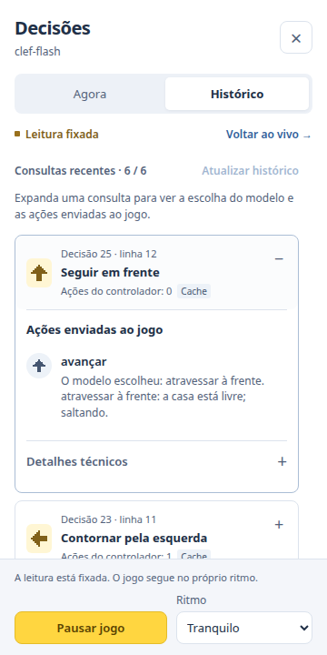
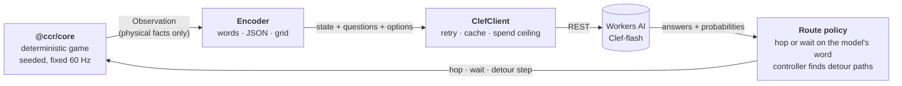

<div align="center">

# Clef Crossy Road

**A decision-model experiment where every move says who made it: the model or the controller.**

[](LICENSE)
[](#quick-start)
[](#repository-layout)
[](https://v2.tauri.app/)
[](https://developers.cloudflare.com/workers-ai/)





<sub>Controls, current decision and expandable history.<br>The decision screenshots replay real cached Clef-flash answers recorded on seed 7 with an earlier controller; they made no API calls.</sub>

</div>

## What is this?

> **Status: research prototype.** The numbers below are small or partial where they say so, and the 100-seed gate is pending.

Clef Crossy Road tests Cloudflare's **Clef-flash** decision model (Workers AI, REST only) in a deterministic, headless
TypeScript port of the rules of Evan Bacon's [Expo-Crossy-Road](https://github.com/EvanBacon/Expo-Crossy-Road).

The default player describes the screen in words and asks the model four one-field lookups: can the chicken stand on the cell
ahead, do things move there, which side should it go round, and can it stay where it is. A fifth lookup asks when to get off
a platform. **The model times every hop:** a cell it calls standable is hopped on at once, and nothing checks, delays or
rescues a wrong answer ([ADR-0012](docs/adr/0012-clef-decides-to-step-off-no-rescue.md),
[ADR-0013](docs/adr/0013-model-times-the-hop.md)). A controller only finds the path of a detour, the hop off a cell the model called
untenable and the way off a platform. The app labels each move as Clef's or the controller's. Other conditions ask the model to
choose each move directly, and the earlier assisted controller (`route`) stays as a control.

A [Tauri v2](https://v2.tauri.app/) desktop app renders the game with Three.js in one window and its controls in another. Browser development keeps an integrated layout, with the same two buttons over the game to hide or show its side panels. Controls groups the player, commands and daily Neurons. Decisions shows
actions and expandable consultation history, with probabilities, latency, tokens and episode statistics in contextual technical details. A Node benchmark CLI compares players on
identical seeds with paired confidence intervals.

Nothing is deployed to Cloudflare. The project only calls the Workers AI REST API and checks a daily free-tier ceiling
(10,000 neurons per UTC day) before each uncached call.

## Results so far

| Player | Games | Rows crossed (mean) |
|---|---:|---|
| `random` | 100 | 1.84 |
| `always-forward` | 100 | 3.78 |
| Clef-flash, plain prompts (JSON, ASCII grid, the player's view of the screen) | 100 | 3.67 – 3.73 (no better than always forward) |
| Clef-flash, top-down image of the observation | 100 | 3.36 (worse) |
| Clef-flash + route controller (`scene` · `route` · `lookup`, earlier revision) | 7 | **22.4** [10.9, 35.7] |
| Scripted controller, **no model** (`exec-route`, same earlier revision) | 100 | 48.3 |
| Scripted controller, **no model** (`exec-route`, 2026-10-17 revision; stall limit 60) | 100 | 61.6 |
| Scripted controller, **no model** (`exec-route`, current controller) | 100 | 65.36 [58.5, 72.2] |
| Scripted chooser, **no model**, hops timed step by step with nothing checking them (`exec-route-live`) | 100 | 68.14 [60.9, 75.2] |
| Clef-flash, hops timed by the model (`route-live`, the current default) | 1 (seed 624140) | 19 (drowned: it called a water row standable at 56%) |
| `lookahead` (reads the simulator, no model) | 100 | 44.75 |

Given the game state and a plain question, Clef-flash plays like "always forward": it puts its highest probability on advancing
even when a platform is elsewhere and the forward hop drowns the chicken. Describing the scene in words,
turning each option into a one-field lookup with solved examples, and letting a controller do the hopping and walk detours
moved it a long way (on a 90-state probe the current default agrees with the ideal follower of the lookups in 92% of the states, the earlier three-lookup design in 94%).

Read the numbers with these caveats:

- **The controller is our code.** In the 7-game row it did the hopping, the timing and the detours, and the model only answered
  three one-field lookups; the fair comparison for that row is the scripted ceiling with the same controller (48.3), not
  `always-forward`. In the current default the model also times the hop and answers whether the chicken can stay where it is,
  while the controller keeps only the paths. Every condition is labelled with how much help the code gives.
- **The historical model row is 7 games**, hence the wide interval. The 100-seed gate is still pending; its earlier estimate was 25,000–30,000 neurons over several days and needs replanning for current gameplay. These seven games span two controller revisions and are not a matched comparison with
  the 100-game scripted references.
- **Current gameplay has changed.** The controller now retries failed sides, walks longer detours and stops after 60 decisions without progress. The 2026-10-17 scripted reference made 61.6 rows. A later platform-exit fix crosses warned rails when the train is distant and keeps control until a resting place; it has no full benchmark yet. There is no matched model evaluation for these versions; the seven-game mean above belongs to the earlier controller and stall limit 40, and the `route-live` row is **one game**. At about 195 consultations a long game, a 100-seed evaluation of the current default would need roughly 150,000 neurons, so it is not planned.

Full tables, method and open questions: [docs/results.md](docs/results.md).

## How it works



- **Deterministic core.** `@ccr/core` uses seeded randomness and fixed simulation ticks: same seed and same actions give an identical
  snapshot hash. Each ported rule cites the upstream file it comes from ([docs/game-rules.md](docs/game-rules.md)).
- **Fairness rule.** The model sees measured physical facts and what a player could perceive (the whole screen, where things will
  be in 0.2 s, its last moves). It never sees a judgement such as "safe", "reachable" or a list of valid moves
  ([ADR-0005](docs/adr/0005-observation-fairness-rule.md), [ADR-0009](docs/adr/0009-perception-memory-judgement.md)).
- **Spend guard.** A daily ceiling is enforced before every API call, in the TypeScript client and again in the Rust process;
  cache hits are free ([ADR-0008](docs/adr/0008-daily-budget-free-tier.md)).
- **Benchmark CLI.** Many seeds × many players, resumable runs, bootstrap confidence intervals and a diagnostic that scores the
  model's probabilities against the real outcome of each move ([docs/benchmark.md](docs/benchmark.md)).

## Quick start

| Needs | For | Version |
|---|---|---|
| Node.js | everything | 24 or newer |
| pnpm | everything | 12.14.0 (pinned in `packageManager`) |
| Git and an internet connection | first run (downloads the game assets) | any |
| Rust and [Tauri platform prerequisites](https://v2.tauri.app/start/prerequisites/) | desktop app only | stable Rust; MSVC C++ build tools and WebView2 on Windows |

```bash
git clone https://github.com/ramon-victor/clef-crossy-road.git
cd clef-crossy-road
pnpm install --frozen-lockfile
pnpm run dev
```

Open **http://localhost:5173**. The first run downloads Evan Bacon's 3D models, audio and font from the pinned upstream revision
(see [Credits and legal](#credits-and-legal)). The browser starts with the **free look-ahead player**, so no token, cache or
Rust is needed. Pick **You** in **Who plays** to play with the arrow keys or WASD. Stop the server with <kbd>Ctrl</kbd>+<kbd>C</kbd>.

The desktop window:

```bash
pnpm run dev:desktop      # Tauri dev mode, hot reload; first build is slow
```

Stop any `pnpm run dev` first: both use port 5173. For a release build, run `pnpm --filter @ccr/desktop build`, then
`pnpm tauri build --no-bundle` inside `apps/desktop`, and double-click `play.cmd`, which also prints what the model is sent.
Keys, the **I** input inspector and the `CCR_*` variables are in [docs/desktop-app.md](docs/desktop-app.md).

> **Platform.** Desktop launch has been checked on Windows; backend tests have also run on Linux. The `.cmd` launchers and WebView2 are Windows-specific. CI checks TypeScript and the web build on Windows, Linux and macOS; native desktop behavior on all three platforms has not been verified.

If an older pnpm fails to load the pinned version, see [pnpm setup](docs/desktop-app.md#pnpm-setup).

## Using a model

1. Create a Cloudflare API token with **only** the *Workers AI* permission and an expiry date.
2. In the app, open **Controls → Cloudflare → Configure**, enter your **Account ID** and the **API token**, and save. They are
   written to the local `.env` and applied without a restart; saving never calls the API. Alternatively copy `.env.example`
   to `.env` and fill in `CF_ACCOUNT_ID` and `CF_API_TOKEN` (the benchmark reads that file too).
3. Choose **Clef-flash** or **Clef (27B)** in **Who plays**.

`.env` is gitignored; never commit it or paste its contents into an issue or pull request.

**Mind the budget.** The project's rule is to stay inside the free tier: 10,000 neurons per UTC day per account. A default Clef-flash
request reads about 2,200 tokens (roughly 7.8 neurons). Because the model is asked again at every step, a long game is on the order
of 150 to 200 requests, around 1,100 to 1,500 neurons before the cache helps, so about four long games fit in a free day; the 27B
model costs about 6.3 times more. Run
`pnpm bench plan` before any benchmark that calls a model: it estimates the cost and splits a run into days that fit.

**Replays are free only with a local cache.** The decision cache lives in `runs/` (gitignored), so a fresh clone has none. The
desktop app opens on Clef-flash at seed 624140, which then calls the API and needs credentials. Use the look-ahead player to stay at
zero cost.

## Benchmark

```bash
pnpm bench plan   --policies always-forward,lookahead --seeds 1..100          # estimate cost, split over days
pnpm bench run    --run my-run --policies always-forward,random,lookahead --seeds 1..100
pnpm bench report --run my-run                                                # means, paired deltas, 95% CIs
pnpm bench show-input --seed 4 --actions hop_forward                          # the exact request a model would get
```

Model players are named `clef:<model>:<encoder>:<strategy>[:<manual>]`, for example `clef:clef-flash:scene:route-live:lookup`
(the default, also spelled `clef`) or `clef:clef-flash:scene:route:lookup` (the control in which the controller checks and times every hop).
`exec-route` and `exec-route-live` are the free scripted ceilings of those two.
The grammar, the reference players, the stall rule and latency injection are in [docs/benchmark.md](docs/benchmark.md).
For a run that contains model probabilities, `pnpm bench diagnose --run <name>` scores P(forward) against real safety; the free reference-only example above has no such probabilities.
Spending commands refuse to start once the day's ceiling is reached; `--daily-neurons` can only lower it.

## Repository layout

| Path | What it is |
|---|---|
| `packages/core` | Deterministic game simulation, zero dependencies |
| `packages/clef` | Workers AI client: schema, retry, cache, spend budget, `Transport` interface |
| `packages/agent` | Players and baselines, encoders, prompts, route controller, episode runner |
| `packages/render` | Three.js scene built from a read-only snapshot |
| `apps/bench` | Benchmark CLI (no window, no GPU) |
| `apps/desktop` | Tauri v2 app: Preact UI plus the Rust side that holds the credentials |
| `docs/` | Architecture, rules, API notes, results, decision records |

Dependency direction: `core` imports nothing; `clef` imports nothing of ours; `render` imports `core`; `agent` imports `core`
and `clef`; the apps wire everything together ([docs/architecture.md](docs/architecture.md)).

## Documentation

| I want to… | Read |
|---|---|
| See what worked and what did not | [docs/results.md](docs/results.md) |
| Understand the design | [docs/architecture.md](docs/architecture.md) |
| See how the game rules were ported | [docs/game-rules.md](docs/game-rules.md) |
| Know what the model is shown | [docs/observation-and-prompts.md](docs/observation-and-prompts.md) |
| Call the Clef API or estimate cost | [docs/clef-api.md](docs/clef-api.md) |
| Run or extend the benchmark | [docs/benchmark.md](docs/benchmark.md) |
| Use the app | [docs/desktop-app.md](docs/desktop-app.md) |
| Maintain the seven UI languages | [docs/internationalization.md](docs/internationalization.md) |
| Know why a decision was made, and what the model decides versus the controller | [docs/adr/](docs/adr/) ([0011](docs/adr/0011-route-controller-three-lookups.md), [0012](docs/adr/0012-clef-decides-to-step-off-no-rescue.md), [0013](docs/adr/0013-model-times-the-hop.md)) |
| Find sources and related work | [docs/references.md](docs/references.md) |

## Development

```bash
pnpm check                                    # typecheck, lint and TypeScript tests
cd apps/desktop/src-tauri && cargo test --lib  # Rust
```

`pnpm --filter @ccr/core test` runs the simulation tests alone, with no network, in a few seconds. See
[CONTRIBUTING.md](CONTRIBUTING.md) before opening a pull request; [AGENTS.md](AGENTS.md) holds the working rules for AI coding
agents. Security notes and how to report a problem: [SECURITY.md](SECURITY.md).

## Reference projects

This project builds on other people's work. The projects below were read for rules, API behaviour and design patterns; the only code
derived from another project is the port of Expo-Crossy-Road's rules, credited in [NOTICE](NOTICE). They are independent of this
repository, we are not affiliated with them, and what is said here comes from reading their READMEs and key source files on
2026-10-20, so it may have changed since. The full list, with the sources behind each claim, is in
[docs/references.md](docs/references.md).

| Project | What we took from it |
|---|---|
| [EvanBacon/Expo-Crossy-Road](https://github.com/EvanBacon/Expo-Crossy-Road) (MIT) | The game: rules, constants and row generation ported to `packages/core`; models, audio and font fetched locally |
| [Cloudflare Workers AI: Clef](https://developers.cloudflare.com/workers-ai/models/clef-flash/) | The decision model and its API: questions, probabilities, limits and price |
| [TypeSafe AI Jev](https://yourstory.com/ai-story/what-is-jev-typesafe-ai-decision-model) and its [docs](https://www.typesafe.ai) | The kind of model this is: typed questions over a `state`. Its advice to "ask about each factor separately and combine the answers with your own logic" shaped the one-field lookups |
| [shantanugoel/mario-jev](https://github.com/shantanugoel/mario-jev) | The model decides the moment of the action at every step, the emulator waits for the answer, and code adds no hazard override: the template for [ADR-0013](docs/adr/0013-model-times-the-hop.md) |
| [fhshaik/typesafe-mario](https://github.com/fhshaik/typesafe-mario) | Actions held for a few frames, the measured delay fed back to the model, and code kept to exact timing arithmetic |
| [RomanSlack/jev-drone](https://github.com/RomanSlack/jev-drone) | Asking only when a decision is needed, reporting how much of the loop is the model, and a rule of thumb: if the model never does something, check that the state carries the fact it needs |
| [FBddcz/embodied-jev](https://github.com/FBddcz/embodied-jev) | The model picks the direction and code the magnitude; no hidden fallback to a rule policy; interventions are counted |
| [SunnyKrS1ngh/JevMario](https://github.com/SunnyKrS1ngh/JevMario) | A contrast: prompts that carry computed hints ("jump now"), which the [fairness rule](docs/adr/0009-perception-memory-judgement.md) forbids here |

Other Jev-driven game projects (Doom, Tetris, StarCraft, Pokemon, Snake and more) are listed in
[docs/references.md](docs/references.md#related-work).

## Credits and legal

- Code and documentation: [MIT](LICENSE).
- The game rules are ported from Evan Bacon's [Expo-Crossy-Road](https://github.com/EvanBacon/Expo-Crossy-Road) (MIT; pinned
  revision in [NOTICE](NOTICE)). Its 3D models, audio and font replicate the original Crossy Road. **They are not in this
  repository**: `scripts/fetch-assets.mjs` downloads them locally and they are gitignored. Release builds embed them, so do not
  distribute binaries without replacing the assets and the name.
- This project is not affiliated with or endorsed by Hipster Whale (makers of Crossy Road), Evan Bacon or Cloudflare.
  "Crossy Road", "Cloudflare" and "Workers AI" belong to their owners.
- The app icon is AI-generated Neural Pilot artwork ([prompt](docs/artwork/app-icon-prompt.md)).
  `pnpm icons` exports the desktop icons and browser favicons from the approved PNG master.
