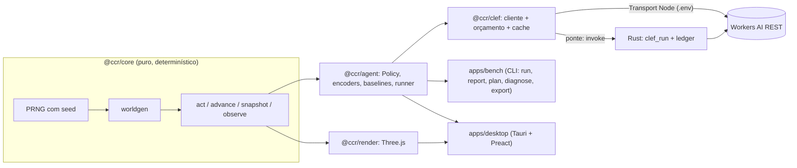

# 02 · Arquitetura

> **Status:** implementada e verificada · **Verificado em:** 2026-10-18 · **ADRs:** 0001 a 0008

## Visão geral



## Configuração local da Cloudflare

**Setup → Cloudflare → Configure** envia os dois valores digitados uma vez ao backend. Rust (desktop)
ou Node (Vite) valida e grava o `.env` da raiz, preservando outras configurações. Os valores salvos têm
precedência sobre o ambiente inicial do app. A leitura de status devolve somente `{ configured }`;
o formulário abre vazio e mantém o jogo pausado. Salvar não faz chamada à Cloudflare.

O backend obtém conta e token juntos por chamada. Trocar as configurações atualiza o orçamento
da conta exibida; uma resposta que já estava em andamento continua sendo registrada na conta original.
Detalhes e limites do armazenamento: [10](10-seguranca-e-licencas.md).

## Pacotes

| Pacote | Responsabilidade | Importa |
|---|---|---|
| `@ccr/core` | Regras, geração de mapa, passo de simulação, snapshot, observação (zero dependências) | nada |
| `@ccr/clef` | Cliente do Workers AI: schema, retry, cache, **orçamento**, métricas, `Transport`; em `@ccr/clef/node`, o ledger e o cache em arquivo (NDJSON) | nada nosso |
| `@ccr/agent` | `Policy`, baselines, encoders (`json`, `grid`, `image`), prompts, `ClefPolicy`, runner com latência injetada (`applyDecision`, usado também para reproduzir partidas gravadas), custo por decisão (`decisionCost`) | `core`, `clef` |
| `@ccr/render` | Cena Three.js a partir de um `Snapshot` somente leitura | `core` |
| `apps/bench` | CLI: `run`, `report`, `plan`, `diagnose`, `export` (N seeds × políticas, NDJSON retomável, IC por bootstrap pareado). `cli.ts` só despacha; opções, comandos, latência e arquivos têm módulo próprio | `core`, `agent`, `clef` |
| `apps/desktop` | Tauri v2: janelas de jogo e controles, painel Preact (um componente por cartão), `Session`, comandos Rust (um módulo por assunto) | `core`, `agent`, `clef`, `render` |

As regras de dependência são impostas pelo layout estrito do `node_modules` do pnpm ([ADR-0003](adr/0003-typescript-pnpm-monorepo.md)). O core
tem uma camada a mais: o `tsconfig` dele não carrega tipos de DOM nem de Node e um teste de pureza varre o código.

## Duas famílias de política, e o tipo como guarda de justiça

```ts
interface ObservationPolicy { kind: "observation"; id; decide(obs: Observation): Promise<Decision> }
interface OraclePolicy      { kind: "oracle";      id; decide(game: Game): Promise<Decision> }
```

Um modelo é sempre uma `ObservationPolicy`: **o tipo impede que ele receba o simulador**, então ele não consegue olhar o que a regra de
justiça ([ADR-0005](adr/0005-regra-de-justica-da-observacao.md)) exclui. Só as referências (look-ahead) são `OraclePolicy`.
`Decision` = `{ action, probabilities?, confidence?, latencyMs?, inputTokens?, neurons?, cached?, extra? }`, mais `sent` (o pedido exatamente
como foi enviado) e `answers` (o `choice` e as probabilidades de **cada** pergunta, que `probabilities` resume numa distribuição conjunta sobre as
cinco jogadas); os dois são para uma pessoa olhar e **não entram** nos registros do benchmark (nem o `extra.controller`, o tipo de cada passo do controlador da rota: `hop`, `wait`, `walk` ou `hold`). `decide(obs, memory?, hooks?)` aceita um
`DecideHooks { onAsk(input) }` opcional: é chamado com o pedido logo antes de ele sair, e não é chamado num passo que o código dá sozinho. Só observa:
a política decide igual sem ele. É o que deixa o app mostrar a pergunta enquanto o modelo ainda lê ([08](08-ui-desktop.md), Modo Teatro).
Humano, baselines e modelos jogam o mesmo ambiente, então as comparações são justas.

## Fluxo de uma decisão (passo-a-passo)

1. `observe(game)` produz uma `Observation` (só fatos físicos; [06](06-observacao-e-prompts.md)).
2. `ClefPolicy` aplica um encoder (JSON, grade ou imagem) e monta a(s) pergunta(s) com o prompt versionado.
3. `ClefClient` consulta o **cache** por hash do pedido; se faltar, pergunta ao **orçamento**; se houver saldo, chama o `Transport`.
4. O Transport faz o POST (Node: `fetch` com o `.env`; desktop: `invoke("clef_run")`, com o token e o teto no Rust).
5. A resposta é normalizada (`result` do REST), validada por schema e vira uma `Decision`.
6. `game.step(action)` aplica a ação e avança 12 ticks. O painel e o log recebem a decisão, a latência, os tokens e os neurons.

## Modos de execução

| Modo | Mundo enquanto o modelo pensa | Onde |
|---|---|---|
| Passo-a-passo | Congelado | Gate do benchmark; modo "Step" do app |
| Latência injetada, serial | Avança o tempo de latência com o herói parado, depois a ação vale | `--latency fixed:<ms>` ou `recorded` |
| Latência injetada, pipelined | A próxima pergunta sai logo após a ação: o salto acontece durante a espera | `--latency fixed:<ms>:pipelined` |
| Tempo real | Corre a 60 Hz, a ação vale quando a resposta chega | Modo "Real-time" do app |

## Ponte para o lado nativo (app desktop)

O `ClefClient` roda no webview do jogo com um `Transport`, um `DecisionCache` e um `SpendBudget` que atravessam uma `Bridge`: `tauri.ts` (IPC
para os comandos Rust) ou `http.ts` (só em `vite serve`, para desenvolver no navegador, servido por `dev-bridge.ts`). Nas duas, quem
tem as credenciais, aplica o teto diário e grava o ledger é o lado nativo, nunca a interface.

O desktop abre dois webviews: `main` é o único dono da `Session`, políticas, cliente, render, áudio
e logs; `controls` recebe snapshots serializáveis e envia comandos por eventos direcionados do Tauri.
O painel não instancia cliente nem simulação. A sincronização inicial e ao reabrir não começa outra
partida; fechar o jogo encerra ambos. A configuração de credenciais permanece somente no painel,
com pausa confirmada antes de abrir. O relógio visual da pergunta é convertido entre as origens
de tempo dos webviews, e eventos nativos sincronizam a preferência de idioma. Nenhuma dessas
operações altera o pedido ao modelo. Ver [08](08-ui-desktop.md).

## Desempenho (medido)

- Simulação: de 0,3 a 2 milhões de decisões por segundo, sem GPU.
- Render: 88 draw calls e 4.444 triângulos por quadro; 180 fps médios no WebView2 ([08](08-ui-desktop.md)). O render usa os modelos do Evan sem `InstancedMesh`: não foi preciso.
- O gargalo do benchmark é a rede. Reexecutar uma seed já jogada não gasta neurons (cache por hash).

## Persistência

Arquivos de texto, sem banco, todos gerados e ignorados pelo git:
`runs/<execução>/episodes.ndjson` (uma linha por partida, com as ações e os registros de cada decisão; retomável), `runs/<execução>/meta.json`,
`runs/cache/clef.ndjson` (respostas do modelo), `runs/cache/spend.ndjson` (ledger de neurons) e `reports/*.md`.
