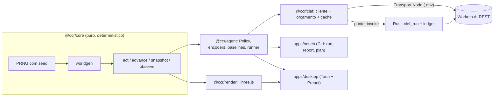

# 02 · Arquitetura

> **Status:** implementada e verificada · **Verificado em:** 2026-10-14 · **ADRs:** 0001 a 0008

## Visão geral



## Pacotes

| Pacote | Responsabilidade | Importa |
|---|---|---|
| `@ccr/core` | Regras, geração de mapa, passo de simulação, snapshot, observação (zero dependências) | nada |
| `@ccr/clef` | Cliente do Workers AI: schema, retry, cache, **orçamento**, métricas, `Transport` | nada nosso |
| `@ccr/agent` | `Policy`, baselines, encoders (`json`, `grid`, `image`), prompts, `ClefPolicy`, runner com latência injetada | `core`, `clef` |
| `@ccr/render` | Cena Three.js a partir de um `Snapshot` somente leitura | `core` |
| `apps/bench` | CLI: `run`, `report`, `plan` (N seeds × políticas, NDJSON retomável, IC por bootstrap pareado) | `core`, `agent`, `clef` |
| `apps/desktop` | Tauri v2: janela, painel Preact, `Session`, comandos Rust | `core`, `agent`, `clef`, `render` |

As regras de dependência são impostas pelo layout estrito do `node_modules` do pnpm ([ADR-0003](adr/0003-typescript-pnpm-monorepo.md)). O core
tem uma camada a mais: o `tsconfig` dele não carrega tipos de DOM nem de Node e um teste de pureza varre o código.

## Duas famílias de política, e o tipo como guarda de justiça

```ts
interface ObservationPolicy { kind: "observation"; id; decide(obs: Observation): Promise<Decision> }
interface OraclePolicy      { kind: "oracle";      id; decide(game: Game): Promise<Decision> }
```

Um modelo é sempre uma `ObservationPolicy`: **o tipo impede que ele receba o simulador**, então ele não consegue olhar o que a regra de
justiça ([ADR-0005](adr/0005-regra-de-justica-da-observacao.md)) exclui. Só as referências (look-ahead) são `OraclePolicy`.
`Decision` = `{ action, probabilities?, confidence?, latencyMs?, inputTokens?, neurons?, cached?, extra? }`.
Humano, baselines e modelos jogam o mesmo ambiente, então as comparações são justas.

## Fluxo de uma decisão (passo-a-passo)

1. `observe(game)` produz uma `Observation` (só fatos físicos; [06](06-observacao-e-prompts.md)).
2. `ClefPolicy` aplica um encoder (JSON, grade ou imagem) e monta a(s) pergunta(s) com o prompt versionado.
3. `ClefClient` consulta o **cache** por hash do pedido; se faltar, pergunta ao **orçamento**; se houver saldo, chama o `Transport`.
4. O Transport faz o POST (Node: `fetch` com o `.env`; desktop: `invoke("clef_run")`, com o token e o teto no Rust).
5. A resposta é normalizada (`result` do REST), validada por schema e vira uma `Decision`.
6. `game.step(action)` aplica a ação e avança 12 ticks. O painel e o log recebem a decisão, a latência, os tokens e os neurons.

## Modos de execução

| Modo | Mundo enquanto o modelo pensa | Onde |
|---|---|---|
| Passo-a-passo | Congelado | Gate do benchmark; modo "Step" do app |
| Latência injetada, serial | Avança o tempo de latência com o herói parado, depois a ação vale | `--latency fixed:<ms>` ou `recorded` |
| Latência injetada, pipelined | A próxima pergunta sai logo após a ação: o salto acontece durante a espera | `--latency fixed:<ms>:pipelined` |
| Tempo real | Corre a 60 Hz, a ação vale quando a resposta chega | Modo "Real-time" do app |

## Ponte para o lado nativo (app desktop)

O `ClefClient` roda no webview com um `Transport`, um `DecisionCache` e um `SpendBudget` que atravessam uma `Bridge`: `tauri.ts` (IPC
para os comandos Rust) ou `http.ts` (só em `vite serve`, para desenvolver no navegador, servido por `dev-bridge.ts`). Nas duas, quem
tem as credenciais, aplica o teto diário e grava o ledger é o lado nativo, nunca a interface.

## Desempenho (medido)

- Simulação: de 0,3 a 2 milhões de decisões por segundo, sem GPU.
- Render: 88 draw calls e 4.444 triângulos por quadro; 180 fps médios no WebView2 ([08](08-ui-desktop.md)). O render usa os modelos do Evan sem `InstancedMesh`: não foi preciso.
- O gargalo do benchmark é a rede. Reexecutar uma seed já jogada não gasta neurons (cache por hash).

## Persistência

Arquivos de texto, sem banco, todos gerados e ignorados pelo git:
`runs/<execução>/episodes.ndjson` (uma linha por partida, com as ações e os registros de cada decisão; retomável), `runs/<execução>/meta.json`,
`runs/cache/clef.ndjson` (respostas do modelo), `runs/cache/spend.ndjson` (ledger de neurons) e `reports/*.md`.
