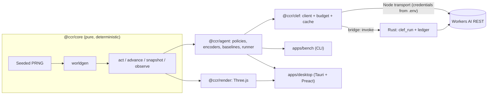

# Architecture

How the packages, the decision loop and the native bridge fit together, and why the stack looks the way it does.

## What this is and is not

Clef Crossy Road tests Cloudflare's Clef-flash decision model in a deterministic, headless TypeScript port of the rules of Evan Bacon's Expo-Crossy-Road. The default player combines the model's lookup answers with a route controller; other conditions choose individual moves. A desktop app shows actions, probabilities, controller steps, latency, cost and rows crossed. The same environment runs without a window to compare players on identical seeds.

| Goals | Non-goals |
|---|---|
| **Rigorous experiment**: measure how well Cloudflare's decision models play, with equal seeds, baselines and confidence intervals | Deploying anything to Cloudflare; the project only calls the Workers AI REST API ([ADR-0002](adr/0002-workers-ai-rest-no-deploy.md)) |
| **Pleasant demo**: desktop app with the original game's models and sounds, the decision panel, a human mode and speed controls | Fine-tuning or self-hosting weights ([ADR-0006](adr/0006-no-fine-tuning-no-self-host.md)) |
| **Reusable base**: the deterministic core can serve as a reinforcement-learning environment | Mobile, multiplayer, a store, unlockable characters, ads; competing with RL agents trained from scratch |
| | Giving the model any help with move safety ([ADR-0005](adr/0005-observation-fairness-rule.md)) |

## Layers



## Packages and dependency rules

| Package | Responsibility | Imports |
|---|---|---|
| `@ccr/core` | Rules, map generation, simulation step, snapshot, observation. Zero dependencies ([game-rules.md](game-rules.md)) | nothing |
| `@ccr/clef` | Workers AI client: schema, retry, adaptive concurrency, cache, **spend budget**, metrics, `Transport`. `@ccr/clef/node` adds the Node REST transport and the NDJSON ledger and cache | nothing of ours |
| `@ccr/agent` | `Policy` types, baselines and scripted references, encoders and word views, versioned prompts, the route controller, `ClefPolicy`, the episode runner with injected latency (`applyDecision` also replays recorded games), cost per decision (`decisionCost`) | `core`, `clef` |
| `@ccr/render` | Three.js scene built from a read-only `Snapshot` | `core` |
| `apps/bench` | CLI: `run`, `report`, `plan`, `diagnose`, `export`, `probe-*`, `show-input`. `cli.ts` only dispatches ([benchmark.md](benchmark.md)) | `core`, `agent`, `clef` |
| `apps/desktop` | Tauri v2 game, settings and decisions windows, Preact UI, a UI-free `Session`, Rust commands and local translation catalogs ([desktop-app.md](desktop-app.md)) | `core`, `agent`, `clef`, `render` |

pnpm's strict `node_modules` layout enforces the directions: a package can import only what its `package.json` declares ([ADR-0003](adr/0003-typescript-pnpm-monorepo.md)). `core` has two more guards: its `tsconfig` loads neither DOM nor Node types, and a purity test scans its sources ([ADR-0004](adr/0004-deterministic-simulation.md)).

## Policy families and the type that guards fairness

```ts
interface ObservationPolicy { kind: "observation"; id: string;
  decide(obs: Observation, memory?: Memory): Promise<Decision> }
interface OraclePolicy      { kind: "oracle"; id: string; decide(game: Game): Promise<Decision> }
```

A model is always an `ObservationPolicy`: **the type keeps the simulator out of its reach**, so it cannot look at what the fairness rule excludes ([ADR-0005](adr/0005-observation-fairness-rule.md)). Only the look-ahead references (`lookahead`, `lookahead-<depth>`, `lookahead-comp:<ms>`) are `OraclePolicy`; the scripted readers (`rule-*`, `exec-*`) read exactly what a model reads. `Memory` holds what a player saw happen: the last six moves, the score and the decisions since the last new row. What may be shown beyond the `Observation` (perception and memory, never judgement) is set by [ADR-0009](adr/0009-perception-memory-judgement.md), and every encoder declares a perception level (`now`, `memory`, `forecast`, `words`). Humans, baselines and models play the same environment, so comparisons are fair.

`Decision` carries `action` plus optional `probabilities`, `confidence`, `latencyMs`, `inputTokens`, `neurons`, `cached`, `extra`, `source` (`model` or `executor`), `note` and `sent` (the exact request, for the inspector).

`Decision.preview` is optional presentation telemetry: the controller's route origin column and per-step action, column and relative row. The search exposes its existing node positions, including platform drift, without another planning pass. The app anchors these coordinates to the observation's original row and tick in `DecisionLog.observed`; the actual action comes from the live snapshot and `SessionState.playback` (the result of `Game.act`). The preview never enters model requests, memory, response cache keys or benchmark episode records. `GameView.setDecisionOverlay` receives only world coordinates and visual states, preserving the renderer's dependency boundary. The compass DOM updates on execution transitions; overlay progress follows simulation ticks in the existing frame loop.

## Life of one decision

1. `observe(game)` produces an `Observation`: measured physical facts only ([observation-and-prompts.md](observation-and-prompts.md)). The runner or the app's `Session` adds the `Memory`.
2. `ClefPolicy` applies an encoder and builds the question or questions from the versioned prompt.
3. `ClefClient` looks the request hash up in the **cache**. On a miss it takes a concurrency slot and asks the **budget**; if there is room it calls the `Transport`.
4. The transport POSTs: in Node with `fetch` and the credentials from `.env`; in the desktop app with `invoke("clef_run")`, where the credentials and the ceiling live in Rust ([clef-api.md](clef-api.md)).
5. The answer is normalised (REST wraps it in `result`), validated by schema and turned into a `Decision`. A successful call is recorded in the ledger and the cache.
6. The action is applied: `game.step(action)` advances `DECISION_TICKS` (12, one hop); with injected latency, `applyDecision` first lets the world run for the wait. The panel and the log receive the decision, latency, tokens and neurons.

With the route controller ([ADR-0010](adr/0010-words-rules-maneuver-executor.md), [ADR-0011](adr/0011-route-controller-three-lookups.md)) the model's answers pick a manoeuvre and the controller issues the hops. Controller-only steps are `Decision.source === "executor"`: no API call, no neurons. Benchmark defaults end an episode on death, after 300 decisions, or after 60 decisions without a new furthest row (`--max-decisions`, `--stall-limit`). Historical results used stall limit 40. The app uses the stall limit without the benchmark's decision cap.

## Run modes

| Mode | World while the model thinks | Where |
|---|---|---|
| Step by step | Frozen | Benchmark default; "Step" in the app |
| Injected latency, serial | Runs for the latency with the hero idle, then the action applies | `--latency fixed:<ms>` or `recorded` |
| Injected latency, pipelined | The next question is asked right after the action, so the hop happens during the wait | `--latency fixed:<ms>:pipelined` |
| Real time | Runs at 60 Hz; the action applies when the answer arrives (queued if a hop is in the air) | "Real-time" in the app |

## Bridge to the native side

In the desktop app `ClefClient` runs in the webview with a `Transport`, a `DecisionCache` and a `SpendBudget` that cross a `Bridge`: `tauri.ts` (IPC to the Rust commands) or `http.ts` (only under `vite serve`, answered by `dev-bridge.ts`, for browser development). In both, the native side holds the credentials, enforces the daily ceiling and writes the ledger; the interface never does. `clef_run` accepts only the three Clef model ids and no caller-supplied URL.

Credentials are entered once in **Setup → Cloudflare**. The native side validates them and writes the root `.env`, preserving other settings; the status call returns only `{ configured }`, the form always opens empty and saving makes no Cloudflare call ([ADR-0007](adr/0007-tauri-desktop-token-in-rust.md), [ADR-0008](adr/0008-daily-budget-free-tier.md), [SECURITY.md](../SECURITY.md)).

## Persistence

Desktop has three webviews. `main` alone owns `Session`, policies, `ClefClient`, scene, audio and logs. `controls` and `decisions` receive serializable snapshots and send acknowledged commands through targeted Tauri events; neither creates a model client or game. Replies are targeted to the requesting window. Closing controls hides its webview and clears credential input; closing decisions hides its webview. Reopening synchronizes presentation state. Inspection requests travel with snapshots so a late webview can still open the right details. Native startup shows only the compact game window. The visual decisions panel uses a pure `DecisionPresentation` projection, with Now, History and Details tabs. Explicit pinning and secondary tabs keep a bounded reading snapshot; scrolling does not freeze it. Its original model inputs are retranslated only for presentation, never rewritten. Display timestamps are converted between the webviews' clock origins. Language preferences are synchronized without changing model inputs ([internationalization.md](internationalization.md)).

Run data is plain text, with no database; the files below are generated and ignored by git. Browser storage holds only non-sensitive UI preferences (locale, conversation, compass and reading pace), never credentials.

| File | Content |
|---|---|
| `runs/<run>/episodes.ndjson` | One line per game: actions and a record per decision. Resumable |
| `runs/<run>/meta.json` | Episode rules fixed when the run starts; resuming under different rules is refused |
| `runs/<run>/failures.ndjson` | Games that failed |
| `runs/cache/clef.ndjson` | Model answers keyed by request hash; replaying a played seed costs nothing |
| `runs/cache/spend.ndjson` | Ledger of neurons spent, per account |
| `reports/*.md` | Generated reports |

## Stack and rejected alternatives

Versions are pinned in `pnpm-lock.yaml` and `Cargo.lock`.

| Layer | Choice | Why | Rejected |
|---|---|---|---|
| Language | TypeScript (strict, ESM) | Upstream is TypeScript; Node 24 runs the `.ts` sources directly, so there is no build step | Plain JavaScript |
| Monorepo | pnpm workspaces, strict layout | Few packages; imports limited to declared dependencies | Turborepo/Nx (overkill), bun, TS project references (nothing to emit) |
| Core | `@ccr/core`, zero dependencies | Testable, fast, reusable as an RL environment | Reusing upstream's engine (coupled to Three.js) |
| PRNG | Hand-written sfc32, one stream per row | Determinism independent of generation order | `Math.random`, libraries |
| Time | Fixed 60 Hz step counted in ticks | Reproduces the original pace without depending on the display | Variable `dt` |
| Rendering | Three.js 0.182 | Imperative scene built from snapshots, reusing upstream's models | React Three Fiber |
| Panel | Preact 11 + Vite 8, i18next | Game logic stays in a UI-free `Session`; translations affect presentation only | React |
| Desktop | Tauri 2 (WebView2) | Light native window; the token stays in Rust | Electron (heavy) |
| Rust | `reqwest` 0.12 (native TLS), `dotenvy` | HTTP call and budget outside the webview | `reqwest` 0.13 as a direct dependency |
| Clef client | `fetch` + zod 4 behind `Transport`, `DecisionCache`, `SpendBudget` | Same code in Node and in the UI | Third-party SDK |
| Persistence | NDJSON, request-hash cache, neuron ledger | Reproducible, auditable, no database | SQLite, D1 |
| Tests | Vitest 5 (TypeScript), `cargo test` (Rust) | Unit tests plus jsdom UI integration tests, with no model calls | Jest |
| Lint and format | Biome 2.5 | One tool | ESLint + Prettier |
| Assets | `scripts/fetch-assets.mjs` | Downloads upstream's models at a pinned revision; they are not redistributed ([NOTICE](../NOTICE)) | Committing the assets |

Two gotchas for contributors:

- `biome migrate` replaces `recommended: true` with `preset: "none"`, which silently disables the lint rules. After any migration, check that `biome.json` still has `"preset": "recommended"`.
- The app depends on `reqwest` 0.12 directly. 0.13 changes the default TLS setup and needs more build tooling on Windows. Tauri itself pulls in 0.13, so both versions appear in `Cargo.lock`; that is expected.

## Open questions

- The core's simulation throughput has no reproducible benchmark script, so no figure is published.
